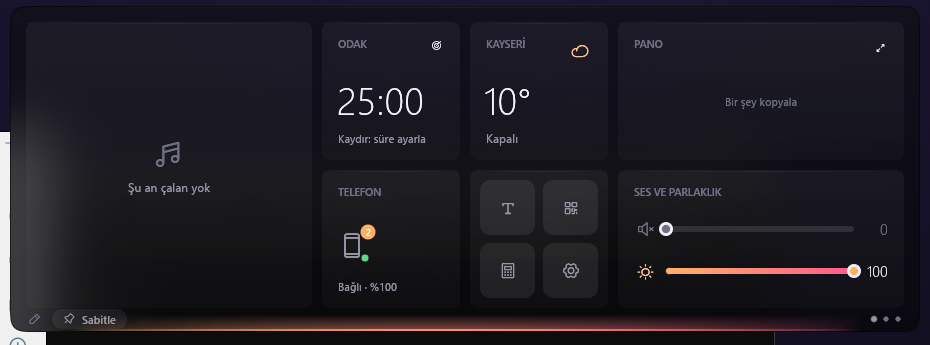

# Zenith

Windows 10/11 için ekranın tepesinde duran cam bir çentik. Üzerine gelince
araç ızgarasına açılır, uzaklaşınca kapanır. Boştayken %0 CPU kullanır.

Rust ile yazıldı: eframe/egui (DirectX 12 veya OpenGL), `windows` crate
(Win32, DWM, Windows.UI.Composition, Windows.Media.Ocr), `tray-icon` ve
`global-hotkey`.

<p align="center"></p>



## Gizlilik

Zenith hiçbir sunucuya veri göndermez: telemetri yok, otomatik güncelleme
yok, hesap yok. Ağı yalnızca şunlar için kullanır:

- **Lens araması**: sen kullandığında tarayıcın seçtiğin alanı Google
  Lens'e gönderir.
- **Telefon bağlantısı**: LocalSend protokolüyle yalnızca yerel ağda, ve
  adb/scrcpy ile telefonuna.
- **Hava durumu**: Open-Meteo'ya (hesap ve anahtar gerektirmez) yalnızca
  seçtiğin şehrin koordinatları gider; şehir aramada yalnızca yazdığın ad.

Pano, ekran görüntüleri, notlar ve dosyalar bilgisayarında kalır
(`%APPDATA%\Zenith`).

## Derleme ve çalıştırma

Gerekenler:

- Rust stable, **MSVC** toolchain (`rust-toolchain.toml` sabitler,
  rustup ilk derlemede kurar).
- Visual Studio 2022 Build Tools, **Desktop development with C++** iş yükü:

  ```bash
  winget install --id Microsoft.VisualStudio.2022.BuildTools -e --override "--quiet --wait --add Microsoft.VisualStudio.Workload.VCTools --includeRecommended"
  ```

Sonra:

```bash
cargo run --release
```

Diğer komutlar:

```bash
cargo test --workspace
cargo clippy --workspace --all-targets -- -D warnings
cargo run --release --features zenith-app/debug-overlay
```

Geliştirme bayrakları: `--pinned` açık ve sabit başlatır, `--settings`
ayarlar sayfasını açar, `--page=<modül id>` bir modülün sayfasını açar
(ör. `--page=phone_link`).

### Kurulum dosyası

`installer\build.ps1`, `zenith.exe`'yi derler ve
[Inno Setup](https://jrsoftware.org/isinfo.php) 6.7+ ile
`dist\Zenith-Setup-<sürüm>.exe` olarak paketler:

```bash
winget install --id JRSoftware.InnoSetup -e
powershell -ExecutionPolicy Bypass -File installer\build.ps1
```

Kurulum yönetici izni istemeden geçerli kullanıcıya kurar, Başlat menüsüne
ekler, isteğe bağlı masaüstü kısayolu ve oturum açılışında başlatma ekler.
Kaldırırken `%APPDATA%\Zenith` klasörünü silmeden önce sorar. İkon ve
sihirbaz görselleri `installer\make_assets.py` ile çizilir.

## Kullanım

- Çentiğin üzerine **gel**: açılır. **Uzaklaş**: kapanır.
- Cama **tıkla**, **CapsLock+N**'ye bas ya da tepside **Pin open**:
  panel açık kalır.
- **Konum**: Ayarlar > Position (Sol, Orta, Sağ).
- **Düzeni düzenle**: ızgaranın sol altındaki kalem. Kutuları sürükle,
  gizle, boyutlandır (Small, Wide, Large).
- Tam ekran bir uygulama ya da oyun öndeyken kendini gizler.
- **Canlı etkinlikler**: müzik çalarken kapalı çentikte kapak, şarkı adı ve
  gerçek ses seviyesine göre oynayan dalga; ses ve parlaklık değişince
  çentikte gösterge. Ses tuşlarını Zenith karşılar, böylece Windows'un ses
  penceresi açılmaz (Ayarlar > Gelişmiş'ten kapatılabilir). Parlaklık
  tuşları donanımda işlendiği için Windows'un parlaklık penceresi görünmeye
  devam eder.

### Araçlar

- **Ekran araçları** (tüm monitörlerde çalışır):
  - **Metin çıkarıcı** (CapsLock+T): Windows OCR ile seçili alandaki metni
    kopyalar.
  - **Renk seçici** (CapsLock+P): büyüteçle renk kopyalar (HEX, RGB, HSL,
    HSV, OKLCH).
  - **Lens araması** (CapsLock+L): seçili alanı Google Lens'te açar.
  - **Font bulucu** (CapsLock+F): seçili metni yüklü fontlarla
    karşılaştırır. İsteğe bağlı [Lens](https://github.com/mixfont/lens)
    modeli (`font_classifier.pt` ve `classes.json`) `%APPDATA%\Zenith\fontnet\`
    klasörüne konursa yüklü olmayan açık kaynak fontları da tanır.
    Model yalnızca kişisel ve ticari olmayan kullanım içindir, bu yüzden
    pakete dahil değildir.
- **Telefon bağlantısı**: Android telefonun çentiğin içinde. LocalSend ile
  iki yönlü dosya ve metin gönderme, scrcpy ile ekran yansıtma, adb ile
  bildirimler. Gelen dosyalar `Downloads\Zenith` klasörüne iner.
- **QR kod** (CapsLock+Q), **Hesap makinesi** (CapsLock+K), **Sistem
  izleyici**, **Takvim**, **Hızlı başlat**, **Ses kaydı** (CapsLock+R),
  **Duvar kâğıdı**, **Pano geçmişi**, **Notlar**, **Zamanlayıcı**,
  **Medya**, **Dosya rafı**, **Ekran görüntüsü**, **Çizim**, **Kahve**
  (bilgisayarı uyanık tutar).

## Eklentiler

Zenith'in koduna dokunmadan yeni kutular eklenebilir. Bir eklenti,
`plugin.toml` ve herhangi bir dilde yazılmış bir programdan oluşan bir
klasördür. Program stdout'a JSON görünümler yazar, stdin'den olayları
okur.

```toml
# %APPDATA%\Zenith\plugins\hello\plugin.toml
id   = "hello"
name = "Hello"
icon = "hand-waving"
size = "wide"
run  = ["python", "main.py"]
```

- **Rehber:** [docs/plugins.html](docs/plugins.html)
- **Örnekler:** [examples/plugins](examples/plugins): sayaç, yapılacaklar
  listesi, PowerShell disk izleyici ve tuvalde çizilen analog saat.
  `zenith://install?example=<id>` linki örneği internete çıkmadan kurar.
- **Yardımcılar:** [sdk/python/zenith.py](sdk/python/zenith.py) ve
  [sdk/node/zenith.js](sdk/node/zenith.js)
- Bir eklentinin `.zip` ya da `.7z` dosyasını çentiğin üstüne bırakmak onu
  kurar.

**Geliştirici modu** (Ayarlar > Advanced): eklenti klasöründe bir dosyayı
kaydetmek eklentiyi yeniden başlatır.

```bash
ZENITH_PLUGIN_PATH="$PWD/examples/plugins" ZENITH_PLUGIN_DEV=1 cargo run --release
```

Eklentiler ayrı süreçler olarak çalışır. Çökmeleri çentiği düşürmez, ama
çalıştırdığın her program kadar yetkileri vardır: yalnızca güvendiğin
eklentileri kur.

## Lisans

MIT. MIT lisanslı açık kaynak bir projenin kodu temel alınarak
geliştirildi; özgün telif bildirimi [LICENSE](LICENSE) içinde korunur.
